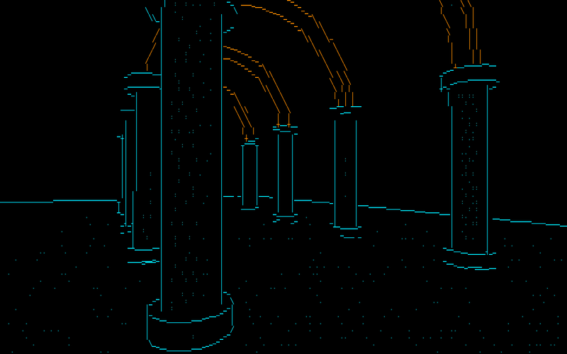
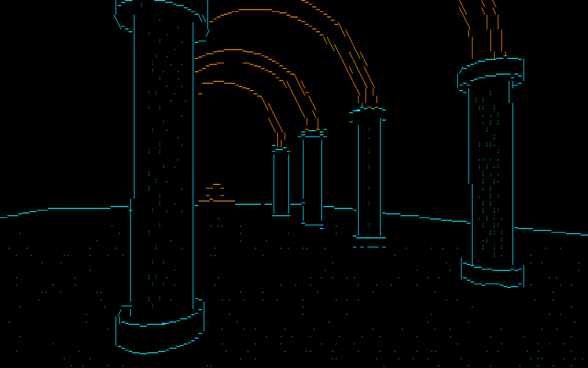

# ascii-shader



A Rust terminal renderer that draws 3D scenes with thin lines and small marks instead of brightness ramps like `.:-=+*#`. It spells the edges of a mesh with line glyphs (`|`, `_`, `/`, box-drawing characters) and keeps a memory of each spelling, so the picture stays calm when the camera moves.

## Run

```
cargo run --release
```

Keys: `W A S D` move, arrows look, `Q`/`E` turn, `space` toggles auto orbit, `1`-`5` mode
(struct, lines, marks, tone, edge), `c` or `v` colour, `m` marks style, `[` `]` mark density,
`h` HUD (mode, ms per frame, fps, live flicker), `x` or `Esc` quit.

Useful flags (see `--help` for all):
- `--mode struct|lines|marks|tone|edge`
- `--scene chapel|shapes`, or `--obj file.obj` (Wavefront, `v` and `f` only)
- `--font`, `--lineset`, `--color`, `--density`
- `--dump N --out DIR [--png] [--dump-start K]` writes frames of the bench camera path as text and PNG
- `--bench` runs every mode for 240 frames at 160x50 and prints metrics (`make bench`)

## How it works

Full spec in [DESIGN.md](DESIGN.md).
- A CPU rasterizer makes a G-buffer (depth, object, triangle, position, normal, light).
- Feature edges of the mesh are projected and a "typist" picks one glyph per cell to spell each edge.
- The typist has memory: every edge keeps its spelling from frame to frame, and only changes it when the new choice is clearly better (hysteresis).
- Nearly horizontal or vertical edges are spelled as runs, one cell per column or row, so they slide instead of crawl.
- Shading comes from anchor marks: points fixed in 3D space (after Garcia et al.), drawn as stipple or other marks where the light needs them. They move with the surface, not with the screen.
- Flicker is measured: a cell flickers when frame t-1 equals frame t+1 but frame t differs (A, B, A).

## Results

Chapel scene, 160x50, 240 frames of a slow orbit, `make bench`:

| mode | flicker | changed |
|------|---------|---------|
| struct (lines + marks) | 0.027% | 4.35% |
| tone (brightness ramp) | 0.188% | 3.81% |
| edge (edge detection) | 0.320% | 3.34% |

Struct flickers about 7x less than tone and 12x less than edge. Frame time is under 10 ms on one machine (Apple silicon).



## Film: ONE CUT (30 s teaser)

A teaser PV for an imaginary anime, made only of terminal cells (glyph and colour, one background colour per frame). Two swordfighters, Mio (cyan) and Kage (orange), kinetic block type, eye close-ups, impact frames, a screen cut in two. Cuts land on the beat (120 BPM). The same frames play in the terminal and in the MP4.

```
python3 tools/pv_audio.py out/pv.wav                            # soundtrack (stdlib only)
cargo run --release -- --play-film --audio out/pv.wav           # play in the terminal (needs 160x45 cells; Esc quits)
cargo run --release -- --film out/pv.mp4 --audio out/pv.wav     # same frames as video (needs ffmpeg)
cargo run --release -- --film-stills "out/stills:2.8,14.1,24.5" # PNG stills at these seconds
```

Ready-made video: [docs/pv.mp4](docs/pv.mp4). The older 30 s short ORB is still there: add `--story orb` (soundtrack `tools/film_audio.py`, video [docs/orb.mp4](docs/orb.mp4)).

Code: `src/pv.rs` (shot list, choreography), `src/fighter2d.rs` (2D cel fighters: key poses, easing, cloth chains, blade streaks), `src/cel.rs` (block font, eye cels, slash/split, grid, moon, embers), `src/film.rs` (shared video and terminal output).

### ONE CUT short (10 s, for X / Reddit / Bluesky)

A separate 10 s cut with its own shot list (not a trim of the 30 s PV): a cyan line draws on black (hook), two eyes, the dash, the clash, a slow-motion last strike, a white-out, the slash and split, the title. The last frame is black like the first, so it loops. Same rule: pure terminal cells.

```
make pvshort                                                    # events -> sound -> sync check -> out/pv-short.mp4 + .gif
cargo run --release -- --story pvshort --film-events out/ev.json # every visual event with its time in seconds
python3 tools/pv_short_audio.py out/ev.json out/s.wav           # sound built from that list (stdlib only)
python3 tools/pv_short_check.py out/ev.json out/s.wav           # sound onset vs picture event, in ms (must be < 1 frame)
cargo run --release -- --story pvshort --play-film --audio out/s.wav
```

The events JSON is the single source of truth: `src/pvshort.rs` writes it, the sound script places every sound at the sample of its event (shot cuts, eye opens, dash, clash, slow motion, flash silence, slash, split, title words, settle, fade). Ready-made: [docs/pv-short.mp4](docs/pv-short.mp4), loop [docs/pv-short.gif](docs/pv-short.gif).

## Credits

Ideas from:
- Riki Yanai, isocontour-church devlog: https://rikiworld.com/isocontour-church/devlog.html
- Garcia et al., "Coherent Mark-based Stylization of 3D Scenes at the Compositing Stage", Eurographics 2021.

No code was copied from either source. Ideas only.

## License

MIT, see [LICENSE](LICENSE).
